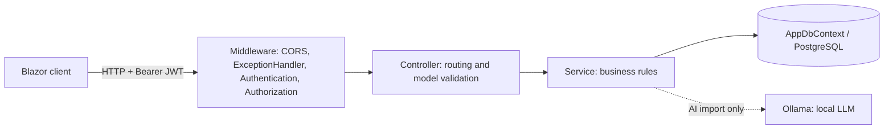
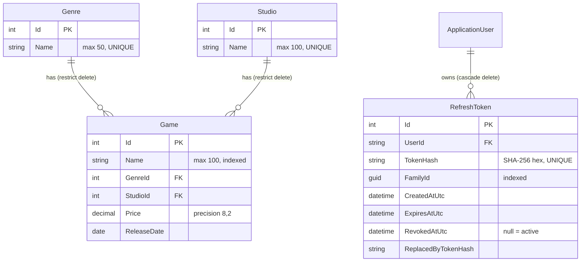
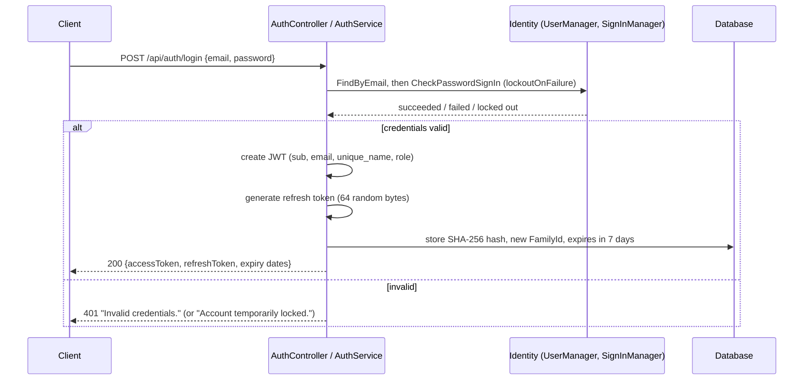
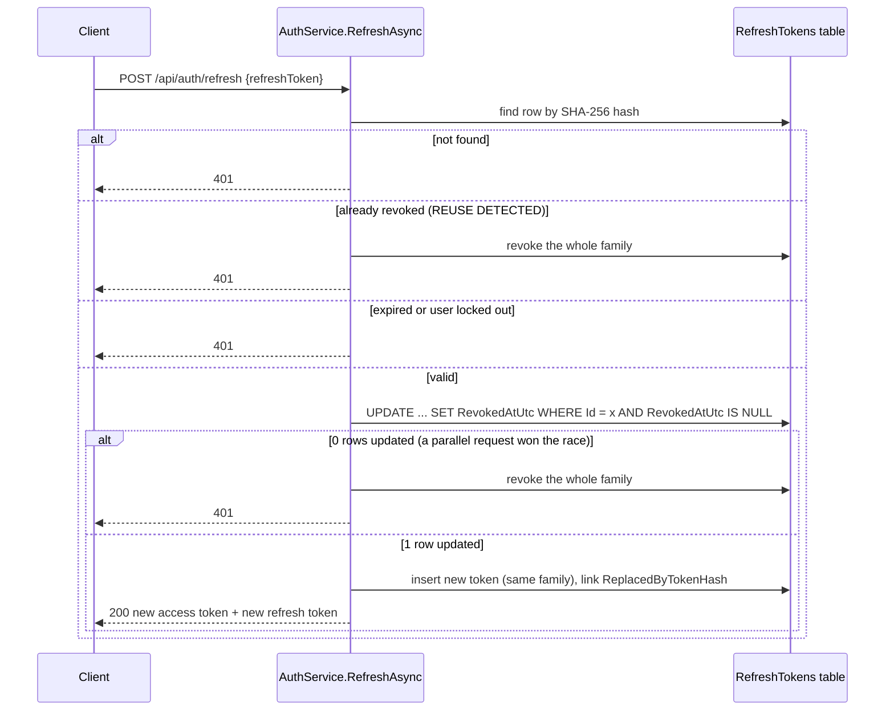
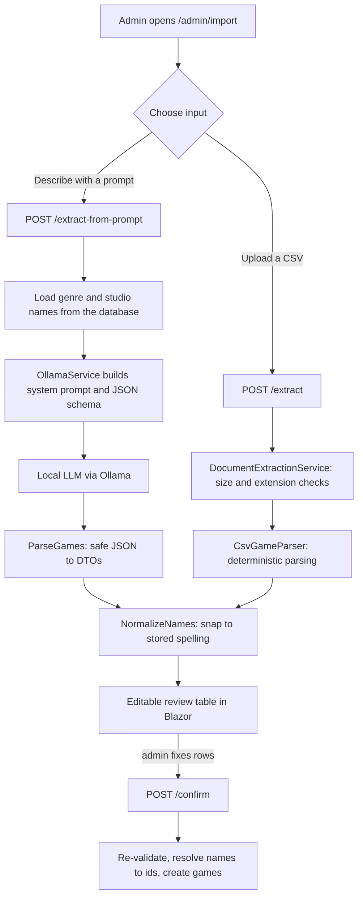

# GameStore — ASP.NET Core 10 · Blazor WebAssembly · PostgreSQL

> **Learning project.** Built to practise modern .NET backend development. It is not audited for production use; the [Security review](#4-security-review) lists what is solid and what still needs work before any real deployment.

GameStore is a small game catalog made of three projects:

| Project | What it is |
|---|---|
| `GameStore.Api` | ASP.NET Core 10 Web API (Controllers) with EF Core, PostgreSQL, ASP.NET Core Identity and JWT |
| `GameStore.Client` | Blazor WebAssembly front end: public game browser, login page, admin import screen |
| `GameStore.Shared` | DTOs and validation attributes shared by the API and the client, so both sides validate the same way |

**Main features**

- Public browsing of games with pagination, search and genre filtering.
- CRUD for games, genres and studios, restricted to the `Admin` role.
- Registration, login, role-based authorization, short-lived JWT access tokens and rotating refresh tokens.
- **AI-assisted game import** (admin only): describe games in plain text (a local LLM proposes structured entries) or upload a CSV, review and edit the rows in a table, then confirm to save.
- Consistent `ProblemDetails` error responses from one global exception handler.

---

## Table of contents

1. [Quick start](#1-quick-start)
2. [Architecture and data model](#2-architecture-and-data-model)
3. [Authentication and authorization](#3-authentication-and-authorization)
4. [Security review](#4-security-review)
5. [AI-powered game import](#5-ai-powered-game-import)
6. [Roadmap](#6-roadmap)

---

## 1. Quick start

**Prerequisites:** .NET 10 SDK, Docker, and (for the AI prompt feature) [Ollama](https://ollama.com).

**1. Create `src/GameStore.Api/.env`** (it is gitignored; never commit it):

```dotenv
POSTGRES_DB=gamestore
POSTGRES_USER=<db user>
POSTGRES_PASSWORD=<db password>
CONN_STRING=Host=localhost;Port=5433;Database=gamestore;Username=<db user>;Password=<db password>

JWT_KEY=<random secret, at least 32 bytes>      # e.g. openssl rand -base64 32
JWT_ISSUER=GameStore
JWT_AUDIENCE=GameStore

# Optional
SeedAdmin__Email=<admin email>                  # creates the first Admin (Development only)
SeedAdmin__Password=<admin password>
Jwt__AccessTokenMinutes=15                      # access-token lifetime, default 15
```

> The access-token lifetime is read from the configuration key `Jwt:AccessTokenMinutes`, which as an environment variable is `Jwt__AccessTokenMinutes`. A variable named `ACCESS_TOKEN_MINUTES` is **not** read by the code (see finding M4).

**2. Start PostgreSQL** (from the `GameStore/` folder, host port `5433`):

```bash
docker compose --env-file src/GameStore.Api/.env up -d
```

**3. Run the API** (from `src/GameStore.Api`, so that `.env` is found):

```bash
cd src/GameStore.Api
dotnet run          # http://localhost:5080 — Swagger UI at /swagger (Development only)
```

In the `Development` environment the API applies EF migrations, creates the `User` and `Admin` roles, creates the seed admin (if `SeedAdmin__*` is set) and inserts a few sample games, genres and studios.

**4. Run the client**

```bash
cd src/GameStore.Client
dotnet run          # http://localhost:5014
```

**5. (Optional) Enable the AI prompt import**

```bash
ollama pull qwen2.5:3b     # the model configured in appsettings.json
ollama serve               # listens on http://localhost:11434
```

| Service | Default address |
|---|---|
| API | `http://localhost:5080` |
| Blazor client | `http://localhost:5014` (the only CORS origin the API allows) |
| PostgreSQL (Docker) | `localhost:5433` |
| Ollama | `http://localhost:11434` |

---

## 2. Architecture and data model

### 2.1 Request flow



- **Controllers** are thin: they declare the route, the authorization attribute and the response types, then delegate.
- **Services** (`GameService`, `GenreService`, `StudioService`, `AuthService`, `TokenService`, `GameImportService`, …) hold the business logic and are registered as scoped services in `ServiceCollectionExtensions`.
- **DTOs** (in `GameStore.Shared`) are the only types that cross the API boundary; entities are never serialized directly. EF queries project straight into DTOs (`GameMappings.Projection`) so only the needed columns are read.
- **Validation** uses DataAnnotations on the DTOs (`[Required]`, `[StringLength]`, `[Range]`) plus two custom attributes: `NoWhitespace` and `ValidReleaseDate` (1950 up to 15 years ahead). `[ApiController]` turns failures into automatic `400` responses.

### 2.2 Data model



- Genre and studio names are unique **at the database level**. Services pre-check for a friendly `409`, and also catch the PostgreSQL unique-violation (`23505`) to cover race conditions.
- Deleting a genre or studio that still has games is blocked (`DeleteBehavior.Restrict`) and reported as `409 Conflict`.
- Names of games, genres and studios are trimmed and stored lower-cased by the services (the seed data is inserted capitalized, so the two styles coexist).
- Identity tables (`AspNetUsers`, `AspNetRoles`, …) live in the same `AppDbContext`.

### 2.3 API endpoints

| Method and route | Access | Notes |
|---|---|---|
| `POST /api/auth/register` | Anonymous | `201`; always creates a `User` (no way to self-assign `Admin`) |
| `POST /api/auth/login` | Anonymous | Returns access and refresh tokens |
| `POST /api/auth/refresh` | Anonymous | Needs a valid refresh token; rotates it |
| `POST /api/auth/logout` | Anonymous | Revokes the refresh-token family; always succeeds |
| `GET /api/games` | Anonymous | Query: `genreId`, `search`, `page`, `pageSize` (1–100, default 10) |
| `GET /api/games/{id}` | Anonymous | |
| `POST` / `PUT` / `DELETE /api/games[/{id}]` | **Admin** | |
| `GET /api/genres[/{id}]`, `GET /api/studios[/{id}]` | Anonymous | |
| `POST` / `PUT` / `DELETE` on genres and studios | **Admin** | |
| `POST /api/ai/games/import/extract` | **Admin** | `multipart/form-data`, field `File` (CSV) |
| `POST /api/ai/games/import/extract-from-prompt` | **Admin** | JSON `{ "prompt": "..." }` |
| `POST /api/ai/games/import/confirm` | **Admin** | JSON `{ "games": [ ... ] }` |
| `GET /health` | Anonymous | Liveness only (no database check) |

Protected calls send `Authorization: Bearer <access token>`.

### 2.4 Error handling

`GlobalExceptionHandler` (an `IExceptionHandler`, the .NET counterpart of Spring's `@ControllerAdvice`) converts exceptions into RFC 9457 `ProblemDetails`.

| Exception | HTTP status |
|---|---|
| `BadRequestException` | 400 |
| `UnauthorizedException` | 401 |
| `NotFoundException` | 404 |
| `ConflictException` | 409 |
| `ServiceUnavailableException` (AI service down or too slow) | 503 |
| Anything else | 500 with a generic title and **no exception detail** (the real error is only logged) |

Model-validation failures return the standard `ValidationProblemDetails` (`400`) with an `errors` map; the Blazor client flattens both shapes into one readable sentence (`ApiErrors`).

---

## 3. Authentication and authorization

**Authentication** answers "who are you?" (login, tokens). **Authorization** answers "what may you do?" (roles). Both are handled by the API; the Blazor client only mirrors the result for display.

### 3.1 The building blocks

| Piece | Role |
|---|---|
| **ASP.NET Core Identity** (`AddIdentityCore<ApplicationUser>` + roles + `SignInManager`) | Stores users and roles, hashes passwords, enforces lockout |
| **JWT access token** | Short-lived, signed proof of identity and roles sent on every request |
| **Refresh token** | Long-lived random secret used only to obtain a new access token; stored hashed in `RefreshTokens` |
| **Roles** `User` and `Admin` | Created at startup (Development). Registration always assigns `User`; `Admin` exists only through the seed user or a manual change in the database |

Identity configuration (`ServiceCollectionExtensions`):

- Unique e-mail required.
- Minimum password length 8. The remaining Identity defaults still apply, so a password also needs an upper-case letter, a lower-case letter, a digit and a symbol.
- Lockout after **5** failed attempts for **15 minutes**.
- Passwords are stored by Identity's `PasswordHasher` (salted PBKDF2); the application never sees or stores a plain password after hashing.

### 3.2 Registration and login



**Register** does the same after creating the user and assigning the `User` role, inside one database transaction, so a failure cannot leave a half-created account. Duplicate username or e-mail returns `409`.

### 3.3 The access token (JWT)

- Signed with **HMAC-SHA256** using `JWT_KEY` (from configuration, never hard-coded).
- Claims: `sub` (user id), `email`, `unique_name`, and one role claim per role.
- Lifetime: **15 minutes** by default (`Jwt:AccessTokenMinutes`).
- On every request the JWT middleware validates: signature, **issuer**, **audience** and **expiry**. A missing `JWT_KEY`, `JWT_ISSUER` or `JWT_AUDIENCE` throws an exception, but only when the JWT options are first built (on the first request that needs authentication), not at startup. Only `CONN_STRING` is checked eagerly.
- An access token is **stateless**: the API does not look it up in the database, which makes it fast but means it cannot be revoked before it expires (see M3).

### 3.4 Refresh tokens: rotation with reuse detection

The refresh token is what keeps an admin logged in for days without keeping a powerful, long-lived JWT around.

- 64 random bytes from `RandomNumberGenerator`, Base64Url encoded (512 bits of entropy). Lifetime **7 days**.
- Only a **SHA-256 hash** is stored (`TokenHash`, unique index). A database leak does not reveal usable tokens. A fast hash is appropriate here because the secret is high-entropy random data, unlike a human password.
- Tokens belong to a **family** (`FamilyId`) that starts at login. Each refresh retires the old token and issues a new one in the same family.



Why this matters: if an attacker steals a refresh token and uses it, then either the attacker or the real user will eventually present an **already-used** token. The API treats that as theft and revokes the entire family, forcing a fresh login. The "claim" step is a single atomic `UPDATE ... WHERE RevokedAtUtc IS NULL`, so two simultaneous refreshes with the same token cannot both succeed.

Roles are re-read from the database on each refresh, so a role change takes effect at the next refresh at the latest.

**Logout** hashes the supplied refresh token and revokes its whole family. It is idempotent and returns `200` even for unknown tokens, so it does not reveal which tokens exist.

### 3.5 Authorization

Authorization is declared on the controllers:

```csharp
[AllowAnonymous] [HttpGet]                    // public catalog
[Authorize(Roles = "Admin")] [HttpPost]       // admin-only write
[Authorize(Roles = "Admin")]                  // whole GameImportController
```

| Resource | Anonymous | `User` | `Admin` |
|---|:-:|:-:|:-:|
| Read games, genres, studios | ✅ | ✅ | ✅ |
| Create / update / delete games, genres, studios | ❌ 401 | ❌ 403 | ✅ |
| AI import (extract and confirm) | ❌ 401 | ❌ 403 | ✅ |

`401` means "not authenticated", `403` means "authenticated but not allowed".

### 3.6 How the Blazor client uses it

| Class | Responsibility |
|---|---|
| `AuthClient` | Login, logout and `GetValidAccessTokenAsync()`. Refreshes the token when it expires within 30 seconds. A `SemaphoreSlim` ensures only one refresh runs at a time, because parallel refreshes would trip the server's reuse detection and log the user out |
| `AuthTokenHandler` | `DelegatingHandler` that adds `Authorization: Bearer ...` to every API call |
| `TokenStore` | Keeps the login response in the browser's `localStorage` (so a page reload does not log the admin out) |
| `ClientAuthStateProvider` + `JwtParser` | Decode the JWT payload (no signature check) to know the user name and roles for the UI |
| `<AuthorizeView Roles="Admin">` | Shows or hides the "Add games" link and the import page |

> **Important:** everything in the client is a *convenience*. The JWT is decoded without verification and the UI can be tampered with in the browser. The only real enforcement is the `[Authorize]` attributes on the API. Hiding a button is never security.

The login page also protects against open redirects: after login it only follows a `returnUrl` that starts with a single `/` (not `//` or `/\`).

---

## 4. Security review

This is a code review of the repository as uploaded. Items marked *(confirmed)* were reproduced with small test programs rather than only read in the code.

### 4.1 Summary

| Area | What the code does | Verdict |
|---|---|---|
| JWT validation | Signature, issuer, audience, lifetime all validated; 15 min default lifetime | ✅ Good (⚠️ 5 min default clock skew, no pinned algorithm) |
| Refresh tokens | Random, hashed at rest, rotation, family revocation, atomic claim | ✅ Strong |
| Passwords | Identity hashing, lockout 5 / 15 min, complexity enforced | ✅ Good (⚠️ DTO says 6, Identity requires 8) |
| Authorization | Role checks on every mutating endpoint | ✅ Good (⚠️ no fallback policy: default is open) |
| Input validation | DataAnnotations on all DTOs, bounded paging, custom attributes | ✅ Good (⚠️ gaps on the import path) |
| SQL injection | EF Core LINQ only, no raw SQL | ✅ Safe |
| XSS | Blazor encodes all output, no raw HTML sinks | ✅ Safe in code (⚠️ tokens in `localStorage`) |
| CSRF | Bearer header, no auth cookies | ✅ Not applicable |
| CORS | One explicit origin, no credentials | ✅ Good (⚠️ hard-coded) |
| File upload | In-memory only, size and extension checks, never stored | ✅ Good (⚠️ a few 500s) |
| Secrets | `.env` gitignored, config from environment | ⚠️ Plaintext credentials in `GameStore.Api.http` |
| Transport | No HTTPS redirection or HSTS | ❌ Gap |
| Brute force / abuse | Per-account lockout only | ⚠️ No rate limiting |
| Security headers | None set | ❌ Gap |
| Error disclosure | Generic 500, no stack traces | ✅ Good |

### 4.2 JWT

**Good**
- Issuer, audience, lifetime and signing key are all validated; none of the `Validate*` flags are disabled.
- The signing key comes from configuration, not from code, and the app throws if it is missing. The key currently in use is 43 characters, which meets the 256-bit minimum for HS256.
- Short access-token lifetime with a separate refresh mechanism limits the damage of a stolen access token.
- Only non-sensitive claims are put in the token (no password, no tokens, no PII beyond e-mail and user name).

**To improve**
- `TokenValidationParameters.ClockSkew` defaults to **5 minutes**, so a "15 minute" token is accepted for about 20. Set `ClockSkew = TimeSpan.FromSeconds(30)` (or `Zero`).
- Pin the algorithm with `ValidAlgorithms = new[] { SecurityAlgorithms.HmacSha256 }`.
- Validate `JWT_KEY`, issuer and audience eagerly at startup (and reject keys shorter than 32 bytes), so a misconfiguration is caught at boot rather than on the first request.
- Access tokens cannot be revoked. After a logout, a lockout or a role removal, an existing access token keeps working until it expires (M3).

### 4.3 Passwords and account protection

- Identity handles hashing and salting; the code never logs or returns passwords.
- Lockout is enabled (5 attempts, 15 minutes) and also checked during refresh.
- The login DTO requires `MinLength(6)` but Identity requires 8 plus complexity. A weak password reaches Identity and comes back as a `400` with Identity's message, which works but is inconsistent. Align the DTO with the real policy so the client can validate up front.
- **Account enumeration (low):** registering an existing e-mail returns an explicit conflict, a locked account returns a different message from a wrong password, and a login for an unknown e-mail returns before any password hashing, so response time differs. These are common trade-offs, but worth knowing.

### 4.4 Input validation

- Every request DTO carries validation attributes; the same attributes run in the API (authoritative) and in the Blazor forms (convenience).
- Paging is bounded (`pageSize` ≤ 100, `page` ≤ 100,000, and the offset is range-checked) to prevent huge scans and integer overflow.
- Game price is limited to 0–1000 and the release date to 1950 through 15 years ahead.
- ✅ *(confirmed)* ASP.NET Core model binding **does** validate attributes placed on positional `record` parameters, including the elements of a list, and `[Required]` rejects whitespace-only strings. This is what protects `POST /confirm`.
- ⚠️ *(confirmed)* The extra `Validator.TryValidateObject(game, ...)` call inside `GameImportService.ImportGamesAsync` **does nothing** for these records: attributes on positional record parameters are not on the properties, which is all `Validator` inspects. It always reports "valid". Remove it, or declare the attributes as `[property: Required]`.
- ⚠️ *(confirmed)* The import path skips rules that `CreateGameRequest` enforces: `ExtractedGameDto` has no `ValidReleaseDate`, so a date such as `1800-01-01` is accepted, and `ReleaseDate` may be `null`, which reaches `(DateOnly)request.ReleaseDate!` in `GameService.CreateAsync` and ends as a **500**. The Blazor UI blocks a missing date, so this needs a direct API call, but the server should not rely on the client.

### 4.5 SQL injection

All data access goes through EF Core LINQ (`Where`, `AnyAsync`, `ExecuteUpdateAsync`, `ExecuteDeleteAsync`) and there is no `FromSql`, `ExecuteSql` or string-built SQL anywhere outside the generated migrations. EF sends every value as a **query parameter**, so user input is never part of the SQL text.

The one place that looks risky is the search:

```csharp
query.Where(g => EF.Functions.ILike(g.Name, $"%{term}%"));
```

The interpolated string is built in C# and then passed to EF as a *value*, so it is parameterized and not injectable. One side effect: `%` and `_` typed by the user act as LIKE wildcards. That is harmless for correctness but can be escaped (`ILike(..., pattern, "\\")` after escaping the term) if exact matching is wanted.

### 4.6 XSS and CSRF

- **XSS:** Razor/Blazor HTML-encodes everything rendered with `@value`. The client contains no `MarkupString`, `innerHTML`, `eval` or similar sinks, and Bootstrap is served locally (no third-party CDN scripts). The API returns JSON only. Game, genre and studio names are free text, but they are always rendered encoded.
- **The real XSS risk is token theft.** Both tokens live in `localStorage`, readable by any script on the page, so any future XSS bug would expose a refresh token. For a learning project this is acceptable; for production prefer a backend-for-frontend with `HttpOnly; Secure; SameSite` cookies, and add a strict Content-Security-Policy.
- **CSRF** is not a concern today: authentication is an explicit `Authorization` header, not an automatically attached cookie. If the design ever moves to cookies, anti-forgery protection becomes mandatory.
- If imported data is ever **exported to Excel/CSV**, prefix cells beginning with `=`, `+`, `-` or `@` to prevent formula injection.

### 4.7 Secrets and configuration

**Good**
- Secrets are read from environment variables / `.env` (`DotNetEnv`) and not hard-coded; `.env` is in `.gitignore`.
- `env.txt` is a blank template, which is a good pattern.
- Swagger and automatic migrations/seeding are Development-only.
- Generic 500 responses and no secrets in logs.

**To fix**
- **`GameStore.Api.http` contains a plaintext admin e-mail and password, plus sample refresh tokens.** The file is tracked and not gitignored. Change that admin password, remove the values, and use `http-client.env.json` (gitignored) or variables instead. If a repository containing such a file was ever public or shared, treat the credentials as compromised.
- Keep `.env`, `.idea/` (IDE HTTP history can contain real tokens and data-source settings) and `GameStore.Client.zip` (a 60 MB archive inside the source tree) out of anything you share or publish; add `*.zip` and `http-client.private.env.json` to `.gitignore`.
- Rotate `JWT_KEY` and the database password if `.env` has ever left your machine. Changing `JWT_KEY` invalidates all access tokens.
- Validate configuration at startup with the options pattern (`ValidateOnStart`) instead of reading `IConfiguration` in several places.
- Use a secret manager (user-secrets locally, a vault or the host's secret store in deployment) rather than files.

### 4.8 CORS

```csharp
.WithOrigins("http://localhost:5014").AllowAnyHeader().AllowAnyMethod()
```

One explicit origin, no wildcard, no `AllowCredentials`: appropriate for a bearer-token API. Move the origin list to configuration before deploying (a deployed client has a different origin). Also note that `AllowedHosts` is `*`; restrict it in production. CORS is a browser rule, not authentication; the API enforces authorization regardless of origin.

### 4.9 File upload safety (CSV import)

| Control | Status |
|---|---|
| Admin only (`[Authorize(Roles = "Admin")]`) | ✅ |
| Size limit 5 MB (server), same limit in the client; Kestrel's default request limit also applies | ✅ |
| Extension allow-list: `.csv` only, case-insensitive | ✅ |
| Never written to disk; read in memory as text | ✅ no path traversal, no stored or executable files |
| Client-supplied filename and `Content-Type` are not trusted or used (only the extension is checked) | ✅ |
| Parsed with a real CSV parser, strict date formats, `decimal` parsing with invariant culture | ✅ |
| Parsing errors become `400` | ⚠️ not always, see below |
| Row-count cap | ⚠️ only on the prompt path and on confirm |

⚠️ *(confirmed)* `TextFieldParser` throws `MalformedLineException` on an unclosed or stray quote, and building the header map throws `ArgumentException` on duplicate column names. Neither is an `AppException`, so the client gets a **500** instead of a helpful `400`. Wrap `CsvGameParser.Parse` and convert these to `BadRequestException`.

⚠️ `/extract` can return as many rows as fit in 5 MB, while `/confirm` accepts at most 50 (the Blazor page only blocks saving and asks the admin to remove the extra rows). Cap or reject oversized CSV results on the server too, with a clear message.

Optional extras: validate the UTF-8 content (reject binary), and add `[RequestSizeLimit]` on the endpoint so the limit is enforced before the body is buffered.

### 4.10 Other findings

- **No HTTPS/HSTS.** The API runs on plain `http://localhost:5080`; there is no `UseHttpsRedirection` or `UseHsts`. Tokens sent over HTTP can be sniffed, so deploy behind TLS and enable both.
- **No rate limiting.** Lockout protects one account but not a script trying many accounts, and it lets an attacker lock a known account on purpose. Add `AddRateLimiter` (per IP) to `login`, `register` and `refresh`.
- **No fallback authorization policy.** A new action without an attribute is public. Add `options.FallbackPolicy = new AuthorizationPolicyBuilder().RequireAuthenticatedUser().Build()` and keep `[AllowAnonymous]` explicit.
- **No security headers** (`Content-Security-Policy`, `X-Content-Type-Options`, `Referrer-Policy`, `Permissions-Policy`).
- **Production bootstrap.** Migrations, role creation and seeding run only when `ASPNETCORE_ENVIRONMENT=Development`. Elsewhere the `User` role would not exist and registration would fail. Create roles unconditionally and apply migrations through a migration bundle or a deployment step.
- **Refresh-token table grows forever** (expired and revoked rows are never purged) and there is no "log out of all devices". Add a cleanup job and a revoke-all endpoint.
- **Failed logins leave a thin audit trail.** The global handler logs a generic warning (`Handled UnauthorizedException: Invalid credentials.`) with no user, e-mail or IP, which is not enough to investigate an attack.
- Smaller items: a functional bug where the client sends `studioId` but `GameQueryParameters` has no such property (the studio filter is silently ignored); `GameStore.Api.http` still references a removed route (`/api/assistant/games/generate`); Swagger has no bearer security definition; `ValidReleaseDate` uses `DateTime.UtcNow` instead of the injected `TimeProvider`.
- Run `dotnet list package --vulnerable` regularly; this review could not check package advisories.

### 4.11 Prioritized fix list

| ID | Priority | Fix |
|---|---|---|
| H1 | High | Remove credentials and tokens from `GameStore.Api.http`; change the admin password |
| H2 | High | Never share or commit `.env`, `.idea/`, big archives; rotate secrets if exposed |
| M1 | Medium | HTTPS redirection, HSTS and TLS in deployment |
| M2 | Medium | Rate limiting on the auth endpoints |
| M3 | Medium | `ClockSkew` to 30 s; consider a token-version or `SecurityStamp` check if instant revocation is needed |
| M4 | Medium | Read `ACCESS_TOKEN_MINUTES` or document `Jwt__AccessTokenMinutes`; today the `.env` value is ignored and 15 is always used |
| M5 | Medium | Fallback authorization policy; CSP; consider cookie-based tokens |
| M6 | Medium | Roles/migrations outside Development; CORS origins from configuration |
| M7 | Medium | Import path: validate `CreateGameRequest` (date range, non-null date), import inside one transaction, remove the no-op `Validator` call |
| L1 | Low | CSV errors to `400`; cap CSV rows at 50 |
| L2 | Low | Align password rules in DTOs and Identity; reduce enumeration signals |
| L3 | Low | Purge old refresh tokens; log failed logins with user and IP; escape LIKE wildcards; fix the studio filter |

---

## 5. AI-powered game import

The import feature lets an admin add many games quickly without typing each one. Its design principle: **the AI only proposes; a human reviews; the server validates again before anything is saved.**

### 5.1 Overview



| | Prompt path | CSV path |
|---|---|---|
| Endpoint | `POST /api/ai/games/import/extract-from-prompt` | `POST /api/ai/games/import/extract` |
| Input | JSON `{ "prompt": "..." }` (5–1000 chars) | `multipart/form-data`, field `File`, `.csv`, max 5 MB |
| Uses the LLM | **Yes** (Ollama) | **No.** It is a plain, deterministic parser |
| Output | Up to 50 `ExtractedGameDto` | `ExtractedGameDto` rows |
| Failure modes | 503 (AI down or too slow), 400 (unusable AI output) | 400 (missing column, bad price or date, empty file) |

Both paths return the same shape and feed the same review and confirm steps.

```json
{ "name": "Hollow Quest", "genreName": "Roleplaying", "studioName": "Ubisoft", "price": 59.99, "releaseDate": "2026-01-01" }
```

### 5.2 The prompt path in detail

1. **Request validation.** `GenerateGameRequest` requires 5–1000 characters; the controller is admin-only.
2. **Context from the database.** `GameImportService` loads all genre and studio names. These lists ground the model in what actually exists in the catalog.
3. **Prompt construction** (`OllamaService.GenerateGamesAsync`). Two chat messages are sent:
    - a **system** message with the rules and the JSON-serialized lists of available genres and studios;
    - a **user** message containing only the admin's text. User text is never concatenated into the system prompt.
4. **Structured output.** The request carries a JSON Schema in Ollama's `format` field. Ollama constrains decoding to that schema, so the reply is valid JSON of the form `{ "games": [ { name, genreName, studioName, price, releaseDate } ] }`. When genres exist, `genreName` is an **`enum`** of the real genre names, so the model physically cannot return a genre that does not exist.
5. **Call settings.** `POST {BaseUrl}/api/chat` with `stream: false`, `temperature: 0.1` (near-deterministic), `num_predict: 2048` (output cap), plus `num_ctx`, `num_thread`, `keep_alive` and `model` from configuration.
6. **Parsing** (`ParseGames`). The JSON is deserialized defensively: entries with a blank name are dropped, strings are trimmed, and `releaseDate` must match `yyyy-MM-dd` exactly, otherwise it becomes `null` (the model can never inject a malformed date).
7. **Normalization** (`NormalizeNames`). Genre and studio names are matched case-insensitively and rewritten to the stored spelling. Unknown names are left untouched so the admin sees and fixes them. Results are capped at **50** games.

**Rules given to the model (system prompt)**

| Rule | Purpose |
|---|---|
| Return only JSON matching the schema | No chatty text to parse |
| Return exactly the number of games requested (default 1) | Predictable results |
| Use the given name, or propose an original one | Fills gaps |
| `genreName` must be from the list; map "action RPG" to the closest listed genre | Avoid invented genres |
| `studioName` from the list; if the user names an unlisted studio, return it exactly as written | Do not silently swap the studio |
| Price: use the given one, otherwise a reasonable value between 0 and 1000 | Respect the server's range |
| Date `YYYY-MM-DD`; a bare year means January 1st | Matches the parser |
| Never invent database IDs | The model has no access to IDs |

**Error handling** (`ExtractGamesFromPromptAsync`)

| What happened | Result for the client |
|---|---|
| Ollama not reachable (`HttpRequestException`) | `503` "The AI service is not reachable. Make sure Ollama is running." |
| Request timed out (the HTTP client allows 6 minutes) | `503` "…took too long… Try a shorter prompt." |
| Empty reply, invalid JSON or schema mismatch | `400` "The AI could not turn that prompt into games. Try rephrasing it." |
| Zero valid games | `400` "No games could be created from that prompt…" |
| Admin cancelled the request | Handled quietly; nothing is written back |

If generation stops at the token limit, a warning is logged (`done_reason == "length"`); the truncated JSON then fails parsing and returns the `400` above. For each call the service also logs model-load time, prompt and output token counts and tokens per second, which helps when tuning the model and hardware.

### 5.3 The CSV path in detail

Despite the "AI" in the feature name, a CSV upload never reaches the LLM:

1. `DocumentExtractionService` rejects empty files, files over **5 MB** and any extension other than `.csv`, then reads the file as text in memory.
2. `CsvGameParser` (Visual Basic `TextFieldParser`, quote-aware) reads the header row. Required columns, matched case-insensitively and in any order: `Name`, `GenreName`, `StudioName`, `Price`, `ReleaseDate`.
3. Each row is parsed: price with `decimal.TryParse` using the invariant culture; date with an exact format (`M/d/yyyy`, `MM/dd/yyyy` or `yyyy-MM-dd`; empty becomes `null`). Fully blank rows are skipped. A bad price or date fails the whole file with a `400` naming the game.
4. `NormalizeNames` snaps genres and studios to the stored spelling, exactly as on the prompt path.

Example file:

```csv
Name,GenreName,StudioName,Price,ReleaseDate
Street Fighter 6,Fighting,Capcom,59.99,2023-06-02
Forza Motorsport,Racing,Playground Games,69.99,10/24/2023
```

(The `NumCtx` comment in `OllamaOptions` about "large CSV files" is a leftover from an earlier design where the LLM read the CSV; it now only matters for long prompts.)

### 5.4 The review step (Blazor `/admin/import`)

- Rows appear in an **editable table**: name, price and date are inputs; genre and studio are `<select>` lists containing only existing values, so an invalid genre or studio cannot be typed.
- If the AI or CSV proposed a genre or studio that does not exist, the cell is cleared and a hint such as *"Ubisoft" does not exist yet* explains why; the admin picks a valid one (or creates the studio first via the API).
- `ImportRow.Validate` mirrors the server rules (name 1–100 characters, price 0–1000, release date 1950 to +15 years, genre and studio required) and highlights problems in red; saving is blocked until every row is valid. Up to 50 rows can be saved at once.
- A long request shows a busy banner with a **Cancel** button (the client's HTTP timeout matches the server's 6 minutes).

This client-side validation is for convenience only. The server validates again.

### 5.5 The confirm step

`POST /api/ai/games/import/confirm` is the only call that writes to the database. `ImportGamesAsync`:

1. Rejects an empty list or more than **50** games.
2. Loads genres and studios once.
3. For every game resolves `GenreName` and `StudioName` to ids with a case-insensitive match. **It never creates a missing genre or studio**; an unknown name is a `400` such as *Studio 'X' does not exist.*
4. Builds `CreateGameRequest` objects and calls the normal `GameService.CreateAsync`, so imported games follow the same rules as games created by hand (trimming, lower-casing, foreign-key checks).

Known limitations (see also 4.4):

- Games are created **one by one**, each with its own `SaveChanges`. If game 7 fails (for example the `null` date case), games 1–6 are already saved. Wrap the loop in a single transaction.
- There is **no duplicate detection**: confirming the same CSV twice creates every game twice (game names are indexed but not unique).
- The release-date range is not re-checked on this path (see 4.4).

### 5.6 Trust model and prompt-injection analysis

Treat the model's output as **untrusted input**, exactly like a form submitted by a stranger. Controls in place:

| Risk | Mitigation |
|---|---|
| Who can trigger the AI | Admin role only (`[Authorize(Roles = "Admin")]` on the controller) |
| Model returns free text or commands | Output is forced into a fixed JSON schema and parsed into typed DTOs; anything else fails |
| Model invents a genre | `enum` constraint in the schema, plus name matching on confirm |
| Model invents a studio, price or date | Studio must exist on confirm; price must be 0–1000; date must match `yyyy-MM-dd` or becomes `null`; the admin sees and edits every value |
| Prompt injection ("ignore your instructions and…") | The model has **no tools, no database access, no network access and no way to trigger actions**. Its only possible effect is a bad row in the review table, which a human must approve and the server re-validates |
| Second-order injection through stored names | Genre/studio names are inserted into the system prompt as JSON string values; only an admin can create them |
| Data leaving the machine | None. The LLM runs locally in Ollama, so prompts and catalog data are not sent to a third party |
| Resource abuse | Admin-only, prompt length limit, `num_predict` cap, 6-minute timeout |

Residual risks to be aware of: the model can still be **wrong** (hallucinated prices, dates or publishers), so the review step is a real control and not a formality; `studioName` is not constrained by an enum (deliberately, to preserve a user-named studio); and the Ollama endpoint has no authentication, so keep it bound to `localhost` and never expose port 11434.

### 5.7 Configuration

`appsettings.json` / `appsettings.Development.json`, section `Ollama` (bound to `OllamaOptions`):

| Key | Value in the repo | Meaning |
|---|---|---|
| `BaseUrl` | `http://localhost:11434` | Where Ollama listens |
| `Model` | `qwen2.5:3b` | Model name (the class default is `qwen2.5:7b`). A 3B model is fast on a CPU but less accurate; try 7B if you have the RAM |
| `KeepAlive` | `30m` | How long Ollama keeps the model loaded after a request, avoiding a slow reload on every call |
| `NumCtx` | `4096` | Context window in tokens; it must fit the prompt plus the output |
| `NumThread` | `4` | CPU threads (omit to let Ollama decide) |

Fixed in code: `temperature = 0.1`, `num_predict = 2048`, HTTP timeout 6 minutes.

The `HttpClient` is registered with `AddHttpClient<IOllamaService, OllamaService>`, which gives proper connection pooling and lets you add resilience policies later.

### 5.8 Ideas to improve the feature

- Make the confirm step atomic (one transaction) and re-run `CreateGameRequest` validation.
- Add duplicate detection (same name + studio + date) and a "create missing genre/studio" option in the review table.
- Constrain `studioName` with an enum plus an explicit `"unknown"` value.
- Cap rows server-side on the CSV path and convert parser exceptions to `400`.
- Add a few-shot example to the prompt and an evaluation set of prompts to compare models.
- Add integration tests with a fake `IOllamaService`, so the pipeline is tested without a running model.
- Remove the unused `OllamaSharp` package reference from `GameStore.Client.csproj` (the client talks only to the API, never to Ollama directly).

---

## 6. Roadmap

Highest-value next steps, taken from the security review (see 4.11 for details):

1. Remove credentials from `GameStore.Api.http`, rotate the admin password and secrets, tighten `.gitignore`.
2. Add HTTPS/HSTS, rate limiting on auth endpoints, a fallback authorization policy and security headers.
3. Fix configuration issues: `Jwt__AccessTokenMinutes` naming, `ClockSkew`, eager configuration validation, CORS origins from configuration.
4. Make the import path robust: full server-side validation, one transaction, CSV errors as `400`.
5. Add automated tests (unit tests for `AuthService` token rotation, integration tests with `WebApplicationFactory` and a test PostgreSQL container).
6. Add structured logging, health checks that include the database, and a CI pipeline (restore, build, test, `dotnet list package --vulnerable`).

---

## Author

**Aymane Jemmaa**

- GitHub: [@aymanee04](https://github.com/aymanee04)
- GitLab: [@aymanee04](https://gitlab.com/aymanee04)
- LinkedIn: [Aymane Jemmaa](https://www.linkedin.com/in/aymane-jemmaa)
- Portfolio: [aymanejemmaa.vercel.app](https://aymanejemmaa.vercel.app)

*Built as a hands-on project to learn modern C# and ASP.NET Core.*